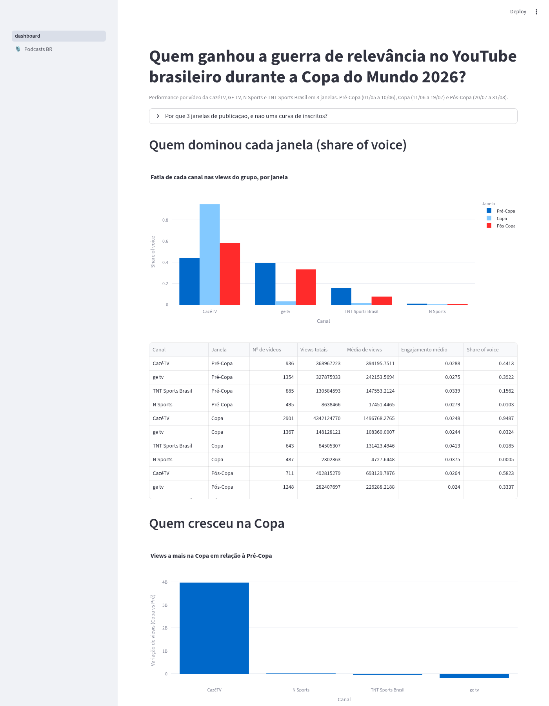
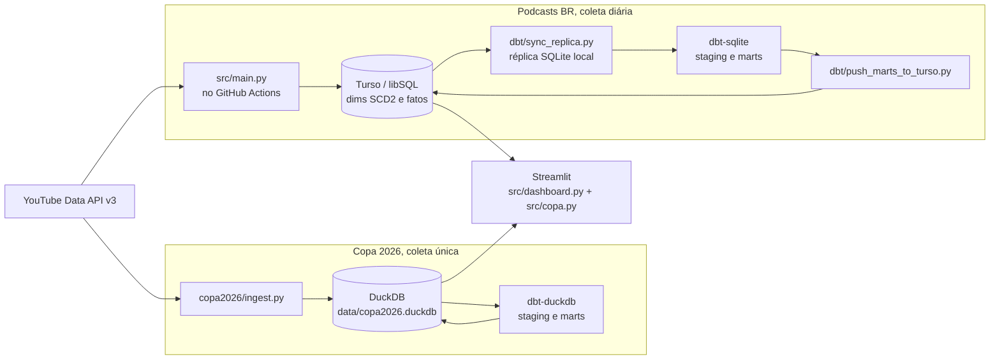

# youtube-audience-pipeline

Quem ganhou a Copa do Mundo 2026 no YouTube brasileiro, e quem segurou a audiência depois da final?

O nome do repo é genérico de propósito. É um pipeline de dados sobre a YouTube Data API v3 (ingestão, dbt e dashboard) que eu apliquei a duas análises, a Copa 2026 como análise principal e um ranking de podcasts brasileiros como segunda.

> TL;DR (English). ELT pipeline on the YouTube Data API v3, applied to two analyses. The main one measures which of 4 Brazilian sports channels won the 2026 World Cup on YouTube (12,231 videos, one-off backfill into a flat DuckDB fact table, dbt-duckdb, Streamlit). The second one tracks 5 Brazilian podcast channels with daily loads on GitHub Actions into Turso, SCD Type 2 dimensions and dbt tests that check the SCD2 invariant. The orchestration was also re-implemented as Apache Airflow DAGs, validated locally. The project is finished and the dashboard stays online, read-only.

[](https://github.com/romualdobarbosa/youtube-audience-pipeline/actions/workflows/tests.yml)
[](LICENSE)


O dashboard está publicado em **[youtubeviewcounter.streamlit.app](https://youtubeviewcounter.streamlit.app/)**. Ele roda no Streamlit Community Cloud, que põe o app pra dormir quando ninguém acessa, então pode aparecer uma tela pra acordar e ele leva alguns segundos pra carregar.



## Duas análises, dois jeitos de coletar

| | Copa 2026 (principal) | Podcasts BR (secundária) |
| --- | --- | --- |
| Coleta | Única e retroativa, as janelas já passaram | Recorrente, diária no GitHub Actions |
| Modelo | Tabela fato flat, um vídeo por linha | Dimensões SCD2 e fatos de snapshot |
| Store | DuckDB, arquivo commitado no repo | Turso (libSQL gerenciado) |
| dbt | `dbt-duckdb` | `dbt-sqlite` sobre uma réplica local |

Esse contraste é o ponto técnico do projeto. A mesma ingestão serve a um caso analítico de carga única e a um caso transacional que acumula histórico, e cada um ganhou o store que combina com o padrão de acesso (decisão em [ADR 0001](docs/adr/0001-duckdb-vs-turso.md)).

## A pergunta da Copa

Quatro canais brasileiros (CazéTV, GE TV, N Sports e TNT Sports Brasil) cobriram a Copa no YouTube. A API (`channels.list`) só devolve os totais acumulados de hoje, sem série histórica, então não dá pra reconstruir uma curva de inscritos. Por isso eu medi a performance dos vídeos publicados em três janelas:

| Janela | Período |
| --- | --- |
| Pré-Copa | 01/05/2026 a 10/06/2026 |
| Copa | 11/06/2026 (abertura) a 19/07/2026 (final) |
| Pós-Copa | 20/07/2026 a 31/08/2026 |

## O resultado

| Canal | Share of voice (Copa) | Crescimento Copa vs Pré-Copa | Δ engajamento Pós vs Copa |
| --- | ---: | ---: | ---: |
| **CazéTV** | **94,9 %** | **+1.077 %** (11,8×) | +0,0016 |
| ge tv | 3,2 % | −54,8 % | −0,0003 |
| TNT Sports Brasil | 1,8 % | −35,3 % | −0,0062 |
| N Sports | 0,1 % | −73,3 % | +0,0020 |

A CazéTV ficou com 94,9% das views do grupo durante a Copa, quase 12 vezes o que fez no pré-Copa. Depois da final ela continuou na frente, com 58,2% das views do grupo no pós-Copa contra 44,1% no pré-Copa, e os outros três voltaram pra perto do patamar de antes. Os números saem dos marts `channel_window_comparison` e `channel_window_metrics` em `data/copa2026.duckdb`.

## Em números

| Métrica | Valor | De onde vem |
| --- | --- | --- |
| Vídeos na análise da Copa | 12.231 (4 canais, 01/05 a 31/08/2026) | `select count(*) from copa_videos` em `data/copa2026.duckdb` |
| Share of voice da CazéTV na Copa | 94,9 % | `channel_window_comparison.copa_share_of_voice` no mesmo arquivo |
| Vídeos de podcast monitorados | 19.892 em 5 canais | `dim_video where is_current = 1` no Turso, último snapshot de 28/09/2026 |
| Snapshots de métricas de vídeo | 548.423 linhas | `fact_video_metrics` no Turso, mesmo snapshot |
| Execuções da ingestão diária | 27 entre 04/09 e 28/09/2026, 26 com sucesso (25 agendadas, todas com sucesso, e 2 manuais, uma com falha) | `gh run list --workflow podcasts-ingest.yml` |
| Linhas do mart `video_growth` na última carga | 528.531 | `video_growth` no Turso. Depois disso `push_marts_to_turso.py` passou a mandar só o top 1.000 (`LIMIT 1000`), mudança que não chegou a rodar porque o cron foi desligado |
| Custo de uma escrita no Turso | ~0,2 s por vídeo | Medição da época, registrada em `src/config.py` e no workflow. Não reverifiquei |
| Testes pytest | 13 | `make test` |
| Nós do `dbt build` da Copa | 13 (3 modelos, 10 testes) | `make dbt-copa` |
| Nós do `dbt build` dos podcasts | 27 (10 modelos, 17 testes) | `make dbt-podcasts` |

## Arquitetura



O cliente da API (`src/api.py`) é o mesmo nas duas análises, com retry e backoff exponencial (tenacity) pra erros transitórios. As datas das janelas da Copa ficam em `vars` do dbt, então mudar uma janela pede só um `dbt build` novo, sem recoletar nada. Os detalhes de cada projeto dbt estão em [docs/dbt.md](docs/dbt.md) e os da análise de podcasts em [docs/podcasts.md](docs/podcasts.md).

## Decisões e trade-offs

- Cota da API. A ideia original era usar `search.list` com filtro de data, que custa 100 unidades por chamada (a cota diária padrão é 10.000). Troquei por `playlistItems.list` na playlist de uploads de cada canal, a 1 unidade por chamada, parando assim que aparece um vídeo mais antigo que o início da janela. As estatísticas vêm de `videos.list` em lotes de 50.
- DuckDB pra Copa e Turso pros podcasts. Carga única e analítica de um lado, escritas pequenas e recorrentes num runner sem disco do outro. Está no [ADR 0001](docs/adr/0001-duckdb-vs-turso.md).
- Dois projetos dbt em grupos uv em conflito. `dbt-sqlite` e `dbt-duckdb` pedem versões de `dbt-core` incompatíveis, então cada um tem seu grupo no `pyproject.toml`, declarados em `[tool.uv] conflicts`. No Docker cada serviço sincroniza o próprio grupo, e no Airflow cada projeto tem sua venv ([docs/dbt.md](docs/dbt.md)).
- Cortei os podcasts de 19 pra 5 canais. Cada escrita no Turso é um round-trip de rede. Os 19 canais davam horas por execução, os 5 com mais inscritos cabem num cron diário.
- Desliguei o cron em setembro de 2026. O `push_marts_to_turso.py` reescrevia o `video_growth` inteiro todo dia e estourou a cota de escrita do plano free do Turso. A coleta já tinha mostrado o SCD2 acumulando histórico, e não faz sentido pagar plano pra um projeto de portfólio. O dashboard segue no ar só com leitura do último snapshot.
- Airflow só validado localmente. Reimplementei as duas orquestrações como DAGs do Apache Airflow com o Astro CLI e validei localmente de ponta a ponta. Em produção a coleta rodou no GitHub Actions. Fiz o Airflow pra aprender a ferramenta, e subir em produção exigiria pagar (o Astro Cloud não tem plano gratuito permanente). Detalhes em [docs/airflow.md](docs/airflow.md).

## Bugs que valeram a pena

### Teste de integridade reprovando dado certo

A primeira execução do workflow de podcasts, disparada à mão em 03/09/2026, é a única falha da tabela acima. Os testes `relationships` dos fatos de métrica quebraram. Eles apontavam pros modelos de staging das dimensões, que filtram `is_current = 1`. Só que um fato antigo aponta legitimamente pra uma versão do canal ou do vídeo que deixou de ser vigente, e assim que um atributo mudou entre duas coletas o teste passou a reprovar dado válido. Troquei o alvo do teste pela dimensão raw, com todas as versões (commit `14c4e25`), e a execução seguinte passou. O teste só falhou quando o SCD2 começou a guardar histórico de verdade.

### Dashboard publicado sem os marts

A página de podcasts no Streamlit Cloud dava `ValueError`. O `dbt-sqlite` grava os marts no arquivo local, que morre junto com o runner do Actions, e o Turso só tinha as tabelas raw da ingestão. Criei o `dbt/push_marts_to_turso.py`, que copia os marts de volta pro Turso no fim do workflow (commit `63c8517`). Três semanas depois foi esse mesmo passo que estourou a cota de escrita.

## Limitações

- O 94,9% é share entre 4 canais de esporte no YouTube, não a fatia da CazéTV na audiência da Copa. A concorrência de verdade era a TV aberta, e a GE TV concentrou a audiência digital no Globoplay, fora desse recorte.
- Medir o impacto fora do YouTube pediria dado fechado. Audiência de TV (Ibope, Kantar) não tem API e sai na imprensa numa unidade que não bate com views. Social listening (X, Instagram) depende de API paga. Por isso respondi só "quem venceu no YouTube", que os dados sustentam de ponta a ponta.
- As métricas da Copa são as views acumuladas até a coleta, feita de uma vez em 03/09/2026, e não as views dentro de cada janela. Um vídeo do pré-Copa teve mais tempo pra acumular.
- A página de podcasts depende do Turso free. Se o banco for pausado ou apagado, ela para de mostrar dados.
- O Airflow nunca rodou em produção.

## Como rodar

### Caminho rápido (sem API key)

Precisa do [uv](https://docs.astral.sh/uv/). O `data/copa2026.duckdb` já vem com os marts prontos.

```bash
git clone https://github.com/romualdobarbosa/youtube-audience-pipeline.git
cd youtube-audience-pipeline
uv sync --python 3.11
make dashboard    # http://localhost:8501
```

A página da Copa abre direto. A de podcasts mostra um aviso de "sem dados", porque depende do Turso ou de uma coleta local.

### Caminho completo

Precisa de uma `YOUTUBE_API_KEY` (Google Cloud Console) no `.env`.

```bash
cp .env.example .env                       # preencha YOUTUBE_API_KEY
uv run python -m copa2026.ingest           # coleta os 4 canais nas 3 janelas
cd copa2026/dbt && uv run --group dbt-copa dbt build --profiles-dir . && cd ../..
make dashboard
```

A análise de podcasts (modo local ou Turso) está em [docs/podcasts.md](docs/podcasts.md), e o deploy no Streamlit Cloud em [docs/streamlit-cloud.md](docs/streamlit-cloud.md).

Com Docker Compose (ou `podman-compose`, com os mesmos argumentos):

```bash
docker compose --profile copa-ingest run --rm copa-ingest   # coleta
docker compose --profile copa-dbt run --rm copa-dbt         # dbt run + dbt test
docker compose up -d dashboard                               # http://localhost:8501
```

## Desenvolvimento

```bash
make install    # uv sync + pre-commit install
make lint       # ruff check + ruff format --check
make test       # pytest (API mockada, SQLite temporário)
make dbt-test   # dbt build da Copa numa cópia do .duckdb e dos podcasts numa fixture sintética
make all        # lint + test + dbt-test
```

O `make dbt-test` também gera uma fixture quebrada, com duas versões vigentes pra mesma chave, e confere que os testes de invariante SCD2 reprovam essa fixture. O pre-commit roda o ruff e regenera `src/requirements.txt` a partir do `uv.lock`. O CI (`.github/workflows/tests.yml`) roda `make lint`, `make test`, `make dbt-copa` e `make dbt-podcasts` em Python 3.11 a cada push e pull request, sem segredo nenhum.

## Stack

Python 3.11, YouTube Data API v3, dbt (dbt-duckdb e dbt-sqlite), DuckDB, SQLite, Turso/libSQL, SQLAlchemy, Streamlit, Plotly, Apache Airflow (Astro CLI), Docker e Docker Compose, GitHub Actions, uv, ruff, pre-commit e pytest.

## Licença

[MIT](LICENSE)
