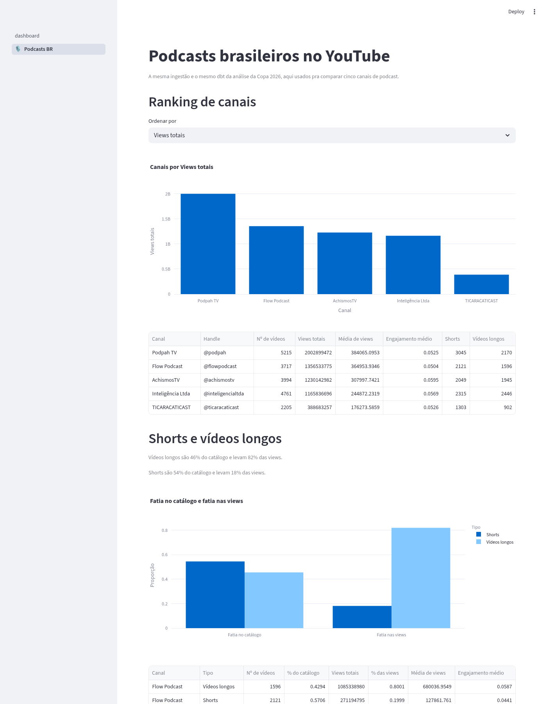

# Podcasts BR

Segunda análise do repo, com o mesmo cliente da YouTube Data API v3. É um ranking de canais de podcast brasileiros com coleta recorrente. As dimensões de canal e vídeo são SCD2 (guardam o histórico de atributos que mudam devagar, como nome e handle), e as métricas entram como fatos de snapshot a cada coleta. O DDL de referência está em [esquema.sql](esquema.sql).



## Por que 5 canais

São Podpah, Flow Podcast, Inteligência Ltda, AchismosTV e TICARACATICAST, os cinco com mais inscritos de uma lista original de 19 (o porquê de cada um está em `src/config.py`). O corte veio da medição contra o Turso. Cada escrita custa um round-trip de rede (uns 0,2 s por vídeo, mesmo em lote, porque o `sqlalchemy-libsql` não implementa o batching do protocolo Hrana pra INSERT). Os 19 canais somavam uns 46 mil vídeos, o que dava horas por execução, e os 5 somam uns 19,5 mil. O `upsert_videos_scd2_batch` em `src/database.py` faz um SELECT por canal em vez de um por vídeo, que foi o ganho que deu pra conseguir.

## Como rodou

O workflow `.github/workflows/podcasts-ingest.yml` rodou todo dia às 06:00 UTC entre 04/09 e 28/09/2026, gravando direto no Turso. O cron está comentado desde então (motivo no [ADR 0001](adr/0001-duckdb-vs-turso.md)). Pra retomar, descomente o `schedule` e rode `gh workflow enable podcasts-ingest.yml`.

## Como rodar localmente

Precisa de `YOUTUBE_API_KEY` no `.env`.

Modo local, gravando em `data/youtube.db`:

```bash
uv run python -m src.main
cd dbt && uv run --group dbt-podcasts dbt build --profiles-dir . && cd ..
uv run python -m src.ranking --by total_views --shorts
```

Modo Turso, o mesmo store do Actions. Preencha `DB_BACKEND=turso`, `TURSO_DATABASE_URL` e `TURSO_AUTH_TOKEN` no `.env` (`turso db create` e `turso db tokens create`):

```bash
uv run python -m src.main                                     # escreve no Turso
uv run --group dbt-podcasts python dbt/sync_replica.py        # Turso -> data/youtube.db
cd dbt && uv run --group dbt-podcasts dbt build --profiles-dir . && cd ..
uv run python dbt/push_marts_to_turso.py                      # marts -> Turso
```

O último passo existe porque o `dbt-sqlite` só grava no arquivo local. Sem ele o dashboard publicado, que lê só o Turso, veria as tabelas raw e não os marts.

Com Docker ou podman, os profiles `ingest` e `dbt` do `docker-compose.yml` fazem a mesma coisa:

```bash
docker compose --profile ingest run --rm ingest
docker compose --profile dbt run --rm dbt
```
